# PsiGestor — Render Deployment, Security & Migration Architecture Guide

## 1. Estrategia de Despliegue en Dos Etapas

PsiGestor se gestiona como un único producto estructurado en dos etapas operativas bien delimitadas:

```mermaid
flowchart TB
    subgraph EtapaA ["ETAPA A — Demostración Académica Gratuita ($0/mes — render.yaml)"]
        Eval["Evaluadores / Psicóloga<br/>(Navegador Web)"]
        MobDemo["App Móvil Ionic/Capacitor<br/>(APK Demo — environment.staging.ts)"]
        WebFree["psigestor-web-staging<br/>Node 22 SSR (plan: free, $0)<br/>Rama: develop"]
        ApiFree["psigestor-api-staging<br/>Python 3.12 Gunicorn (plan: free, $0)<br/>Rama: develop"]
        DbFree[("psigestor-db-staging<br/>PostgreSQL (plan: free, $0)<br/>Datos 100% ficticios — Expira a los 30 días")]

        Eval -->|"HTTPS First-Party Cookie<br/>HttpOnly + SameSite=Lax + CSRF"| WebFree
        WebFree -->|"/backend-api/* (Proxy SSR 65s timeout)"| ApiFree
        MobDemo -->|"HTTPS Bearer AccessToken (RAM)<br/>+ RefreshToken (Android Keystore)"| ApiFree
        ApiFree -->|"Internal DATABASE_URL"| DbFree
    end

    subgraph EtapaB ["ETAPA B — Infraestructura Profesional Completa ($40/mes — render.production.yaml)"]
        WebProd["psigestor-web (plan: starter, $7)"]
        ApiProd["psigestor-api (plan: starter, $7)"]
        DbProd[("psigestor-db-prod<br/>(plan: basic-256mb, $6)<br/>Respaldos diarios")]
        WebStg["psigestor-web-staging (plan: starter, $7)"]
        ApiStg["psigestor-api-staging (plan: starter, $7)"]
        DbStg[("psigestor-db-staging<br/>(plan: basic-256mb, $6)")]

        WebProd --> ApiProd --> DbProd
        WebStg --> ApiStg --> DbStg
    end
```



---

## 2. Límites del Plan Gratuito de Render y Mitigaciones Implementadas

| Límite de Render Free | Impacto Técnico | Mitigación Implementada en PsiGestor |
|---|---|---|
| **Límite de 1 base de datos gratuita por cuenta** | Intentar crear Staging y Producción gratuitos en un mismo Blueprint aborta el despliegue. | Separación de Blueprints: `render.yaml` aprovisiona exclusivamente Staging (`plan: free`). `render.production.yaml` define la arquitectura profesional de pago. |
| **Suspensión tras 15 min de inactividad (Cold Start 30–50s)** | La primera petición tras inactividad tarda en responder y puede provocar un `502 Bad Gateway` en el proxy web. | En `frontend/src/server.ts` se configuró `signal: createProxyAbortSignal(65000)` en el proxy `/backend-api`, permitiendo absorber el arranque en frío del backend sin errores. |
| **Expiración de PostgreSQL Free a los 30 días** | Render elimina la base de datos gratuita tras 30 días continuos. | Procedimiento de reconstrucción en 10 segundos: se crea una nueva base de datos gratuita y se ejecutan `--migrate-only` y `--seed-academic-demo` para regenerar el catálogo y citas dinámicas. |
| **`preDeployCommand` requiere planes de pago** | Los despliegues automáticos no pueden ejecutar migraciones antes del inicio del contenedor. | Se implementó el flujo de migración manual controlada con `--verify-only` y `--migrate-only`. |

---

## 3. Seguridad de Datos y Gestión de Semillas

### 3.1 Bloqueo Estricto de Semillas Históricas en Entornos Públicos
Los archivos en `database/seeds/` (`001_students_test_data.sql`, `004_student_user.sql`, etc.) contienen matrículas y nombres reales de integrantes del equipo de desarrollo, así como contraseñas públicas (`password123`).
- **Regla permanente:** Las semillas históricas quedan **estrictamente bloqueadas** en Staging, Producción y en Render (`should_load_demo_seeds() == False`).
- Únicamente pueden ejecutarse en desarrollo local puro (`APP_ENV=development` fuera de Render).

### 3.2 Aprovisionamiento Seguro de Demostración (`--seed-academic-demo`)
Para la evaluación académica en Staging o demostraciones públicas, se diseñó el comando:
```bash
python -m app.init_db --seed-academic-demo
```
**Características obligatorias:**
1. **Idempotencia:** Utiliza `ON CONFLICT DO NOTHING`. Si se ejecuta múltiples veces, no borra ni duplica información.
2. **Rechazo de Producción:** Si `APP_ENV=production`, aborta inmediatamente con `MigrationError`.
3. **No destructivo:** No ejecuta `TRUNCATE`, `DELETE` ni reinicializa datos existentes.
4. **Cero contraseñas públicas:** Las contraseñas del psicólogo demo y de los alumnos demo se leen exclusivamente desde variables de entorno (`INITIAL_PSYCHOLOGIST_PASSWORD` y `DEMO_STUDENT_PASSWORD`), se rechazan contraseñas prohibidas (`password123`, `admin`, etc.) o de menos de 10 caracteres, y se generan hashes seguros con `scrypt` al vuelo.
5. **Datos 100% ficticios:** Inserta exclusivamente estudiantes ficticios:
   - `DEMO2026001` — Estudiante Demo Uno (ISC, 6to semestre)
   - `DEMO2026002` — Estudiante Demo Dos (Administración, 4to semestre)
   - `DEMO2026003` — Estudiante Demo Tres (Mecatrónica, 8vo semestre)
6. **Disponibilidades dinámicas:** Genera bloques de horarios habituales a 90 días desde la fecha actual en tiempo real.

---

## 4. Procedimiento de Migración Manual Controlada (Staging / Demo)

### Paso 1: Auditoría de solo lectura (`--verify-only`)
```bash
DATABASE_URL="<RENDER_EXTERNAL_DB_URL>?sslmode=require" \
APP_ENV=staging \
PYTHONPATH=backend \
python -m app.init_db --verify-only
```
- Comprueba la tabla `schema_migrations`.
- Verifica que los checksums SHA-256 de todas las migraciones aplicadas coincidan con el repositorio.
- Informa si existen migraciones pendientes sin modificar la base de datos.

### Paso 2: Aplicación atómica de migraciones (`--migrate-only`)
```bash
DATABASE_URL="<RENDER_EXTERNAL_DB_URL>?sslmode=require" \
APP_ENV=staging \
PYTHONPATH=backend \
python -m app.init_db --migrate-only
```
- Adquiere el candado de sesión `pg_advisory_lock(7392045112840195)`.
- Ejecuta las migraciones pendientes en transacciones aisladas.

### Paso 3: Aprovisionamiento de datos de evaluación ficticios (`--seed-academic-demo`)
```bash
DATABASE_URL="<RENDER_EXTERNAL_DB_URL>?sslmode=require" \
APP_ENV=staging \
INITIAL_PSYCHOLOGIST_EMAIL="psicologia.demo@psigestor.demo" \
INITIAL_PSYCHOLOGIST_PASSWORD="<CLAVE_SEGURA_DEMO>" \
DEMO_STUDENT_PASSWORD="<CLAVE_SEGURA_ALUMNO>" \
PYTHONPATH=backend \
python -m app.init_db --seed-academic-demo
```

---

## 5. Procedimiento de Transición de la Demostración a la Infraestructura Profesional (Etapa A → Etapa B)

Cuando el proyecto reciba la aprobación formal de la psicóloga y los evaluadores institucionales para operar en producción real:

1. **Aprovisionar la Infraestructura Profesional:**
   - En el dashboard de Render, seleccionar *New -> Blueprint* y apuntar al archivo `render.production.yaml`.
   - Se crearán las dos bases de datos persistentes (`psigestor-db-staging` y `psigestor-db-prod` en `basic-256mb`) y los servicios dedicados 24/7 en `starter`.
2. **Aislamiento Total de Datos (No migrar datos demo a producción):**
   - La base de datos de producción `psigestor-db-prod` inicia completamente limpia.
   - **No se copian citas ni alumnos ficticios de la demo a producción.**
   - Se ejecuta únicamente la estructura formal de base de datos:
     ```bash
     DATABASE_URL="<PROD_DATABASE_URL>?sslmode=require" \
     APP_ENV=production \
     PYTHONPATH=backend \
     python -m app.init_db --migrate-only
     ```
3. **Aprovisionar la Cuenta Real de la Psicóloga:**
   - En las variables de entorno de `psigestor-api` en Render, configurar:
     - `INITIAL_PSYCHOLOGIST_EMAIL="correo.institucional@itescam.edu.mx"`
     - `INITIAL_PSYCHOLOGIST_PASSWORD="<CLAVE_OFICIAL_ROBUSTA>"`
   - Al desplegarse el backend o al ejecutarse `--migrate-only`, se crea la cuenta oficial con rol `psicologo`.
4. **Generar Secretos Criptográficos Exclusivos:**
   - Render generará nuevos `SECRET_KEY` y `MOBILE_TOKEN_SECRET` exclusivos para producción.
5. **Compilar la Aplicación Móvil para Producción:**
   - Compilar el proyecto móvil apuntando al backend de producción:
     ```bash
     cd mobile
     npx ng build --configuration production
     npx cap sync android
     ```
   - El APK resultante se conectará a `https://psigestor-api.onrender.com` con tokens seguros en Android Keystore.

---

## 6. Protocolo de Respaldo y Restauración PostgreSQL

> [!CAUTION]
> **Advertencia sobre `pg_restore --clean`:**
> El flag `--clean` ejecuta sentencias `DROP` destructivas sobre las tablas existentes.
> - **NUNCA ejecutes una restauración con `--clean` directamente sobre la base de datos de producción en vivo.**
> - **SIEMPRE restaura primero sobre una base de datos de recuperación independiente y audita la integridad antes de redirigir el tráfico.**

### Respaldo Lógico Preventivo:
```bash
pg_dump "<RENDER_EXTERNAL_DB_URL>?sslmode=require" \
  --format=custom \
  --no-owner \
  --no-privileges \
  --file="backup_psigestor_$(date +%Y%m%d_%H%M%S).dump"
```

### Verificación del Archivo de Respaldo:
```bash
pg_restore --list "backup_psigestor_YYYYMMDD_HHMMSS.dump"
```

### Restauración No Destructiva en Base de Datos Aislada:
```bash
pg_restore \
  --no-owner \
  --no-privileges \
  --exit-on-error \
  --dbname="<RECOVERY_DATABASE_URL>?sslmode=require" \
  "backup_psigestor_YYYYMMDD_HHMMSS.dump"
```
