# PsiGestor — Render Deployment, Security & Migration Architecture Guide

## 1. Estrategia de Despliegue en Dos Etapas

PsiGestor se gestiona como un único producto estructurado en dos etapas operativas bien delimitadas:

```mermaid
flowchart TB
    subgraph EtapaA ["ETAPA A — Demostración Académica Gratuita ($0/mes — render.yaml + Neon Free)"]
        Eval["Evaluadores / Psicóloga<br/>(Navegador Web)"]
        MobDemo["App Móvil Ionic/Capacitor<br/>(APK Demo — environment.staging.ts)"]
        WebFree["psigestor-web-staging<br/>Node 22 SSR (plan: free, $0)<br/>Rama: develop"]
        ApiFree["psigestor-api-staging<br/>Python 3.12 Gunicorn (plan: free, $0)<br/>Rama: develop"]
        DbNeon[("psigestor-academic-demo<br/>PostgreSQL en Neon Free<br/>1 GB persistente — Sin expiración a 30 días")]

        Eval -->|"HTTPS First-Party Cookie<br/>HttpOnly + SameSite=Lax + CSRF"| WebFree
        WebFree -->|"/backend-api/* (Proxy SSR 65s timeout)"| ApiFree
        MobDemo -->|"HTTPS Bearer AccessToken (RAM)<br/>+ RefreshToken (Android Keystore)"| ApiFree
        ApiFree -->|"Direct TLS Connection (sslmode=require)"| DbNeon
    end

    subgraph EtapaB ["ETAPA B — Infraestructura Profesional Completa ($40/mes — render.production.yaml)"]
        WebProd["psigestor-web (plan: starter, $7)"]
        ApiProd["psigestor-api (plan: starter, $7)"]
        DbProd[("psigestor-db-prod<br/>(plan: basic-256mb, $6)<br/>Respaldos diarios")]
        WebStg["psigestor-web-staging (plan: starter, $7)"]
        ApiStg["psigestor-api-staging (plan: starter, $7)"]
        DbStg[("psigestor-db-staging<br/>(plan: basic-256mb, $6)")]

        WebProd --> ApiProd --> DbProd
        WebStg --> ApiStg --> DbStg
    end
```



---

## 2. Límites de los Planes Gratuitos y Mitigaciones Implementadas

| Componente | Límite Técnico | Mitigación Implementada en PsiGestor |
|---|---|---|
| **Render Web Services Free** | **750 horas compartidas al mes** entre `psigestor-api-staging` y `psigestor-web-staging`. | Los servicios entran en suspensión automática tras 15 minutos sin tráfico HTTP. Para la demo de 1 a 2 semanas, el consumo estimado es de 70 a 196 horas, manteniéndose muy por debajo del límite de 750h. **Prohibido configurar pings continuos (ej. UptimeRobot)**. |
| **Render Cold Start (20–45s)** | La primera petición tras inactividad tarda en responder mientras el contenedor despierta. | En `frontend/src/server.ts` se configuró `signal: createProxyAbortSignal(100000)` (100 segundos) en el proxy `/backend-api`, permitiendo absorber el arranque en frío del backend sin errores HTTP 504 ni 502 por timeout prematuro. |
| **Neon PostgreSQL Free** | **1 GB de almacenamiento, 100 CU-hours/mes (0.25 CU)**. | El esquema y datos demo de PsiGestor ocupan ~4 MB (< 0.5% del límite). A 0.25 CU, 100 CU-h rinden hasta 400 horas de cómputo activo con suspensión a los 5 minutos de inactividad. |
| **Vigencia de la Base de Datos** | Render Free eliminaba PostgreSQL a los 30 días. | **Eliminado:** Al utilizar Neon Free, la base de datos es permanente y no caduca a los 30 días. |
| **Conexiones y Advisory Locks** | PgBouncer (`-pooler`) en modo transacción es incompatible con advisory locks de sesión. | `DATABASE_URL` utiliza obligatoriamente el **Endpoint Directo de Neon** (hasta ~100 conexiones directas). Con 8 hilos en Gunicorn, el pico máximo de conexiones es de ~10 (10% de la capacidad). |

---

## 3. Seguridad de Datos y Gestión de Semillas

### 3.1 Bloqueo Estricto de Semillas Históricas en Entornos Públicos
Los archivos en `database/seeds/` (`001_students_test_data.sql`, `004_student_user.sql`, etc.) contienen datos históricos de desarrollo local.
- **Regla permanente:** Las semillas históricas quedan **estrictamente bloqueadas** en Staging, Producción y en Render (`should_load_demo_seeds() == False`).
- Únicamente pueden ejecutarse en desarrollo local puro (`APP_ENV=development` fuera de Render).

### 3.2 Aprovisionamiento Seguro de Demostración (`--seed-academic-demo`)
Para la evaluación académica en Staging o demostraciones públicas, se diseñó el comando:
```bash
python -m app.init_db --seed-academic-demo
```
**Características obligatorias:**
1. **Idempotencia:** Utiliza `ON CONFLICT DO NOTHING`. Si se ejecuta múltiples veces, no borra ni duplica información.
2. **Rechazo de Producción:** Si `APP_ENV=production`, aborta inmediatamente con `MigrationError`.
3. **No destructivo:** No ejecuta `TRUNCATE`, `DELETE` ni reinicializa datos existentes.
4. **Cero contraseñas públicas:** Las contraseñas del psicólogo demo y de los alumnos demo se leen exclusivamente desde variables de entorno (`INITIAL_PSYCHOLOGIST_PASSWORD` y `DEMO_STUDENT_PASSWORD`), se rechazan contraseñas prohibidas (`password123`, `admin`, etc.) o de menos de 10 caracteres, y se generan hashes seguros con `scrypt` al vuelo.
5. **Datos 100% ficticios:** Inserta exclusivamente estudiantes ficticios con matrículas `DEMO2026...`.
6. **Disponibilidades dinámicas:** Genera bloques de horarios habituales a 90 días desde la fecha actual en tiempo real.

---

## 4. Procedimiento de Migración Manual Controlada en Neon (PowerShell y Bash)

### En Windows PowerShell:
```powershell
# 1. Configurar variables de sesión de forma segura sin exponer secretos en consola
$NeonUrl = Read-Host -Prompt "Ingrese la DATABASE_URL directa de Neon (con ?sslmode=require)" -AsSecureString
$Bstr = [System.Runtime.InteropServices.Marshal]::SecureStringToBSTR($NeonUrl)
$env:DATABASE_URL = [System.Runtime.InteropServices.Marshal]::PtrToStringAuto($Bstr)
$env:APP_ENV = "staging"
$env:PYTHONPATH = "backend"

# 2. Paso A: Auditoría de solo lectura (--verify-only)
python -m app.init_db --verify-only

# 3. Paso B: Aplicación de migraciones (--migrate-only)
python -m app.init_db --migrate-only

# 4. Paso C: Aprovisionamiento de datos ficticios dinámicos (--seed-academic-demo)
$PsychPass = Read-Host -Prompt "Ingrese contraseña para el psicólogo demo (mín. 10 chars)" -AsSecureString
$BstrPsych = [System.Runtime.InteropServices.Marshal]::SecureStringToBSTR($PsychPass)
$env:INITIAL_PSYCHOLOGIST_PASSWORD = [System.Runtime.InteropServices.Marshal]::PtrToStringAuto($BstrPsych)

$StudentPass = Read-Host -Prompt "Ingrese contraseña para alumnos precargados (mín. 10 chars)" -AsSecureString
$BstrStudent = [System.Runtime.InteropServices.Marshal]::SecureStringToBSTR($StudentPass)
$env:DEMO_STUDENT_PASSWORD = [System.Runtime.InteropServices.Marshal]::PtrToStringAuto($BstrStudent)
$env:INITIAL_PSYCHOLOGIST_EMAIL = "psicologia.demo@psigestor.demo"

python -m app.init_db --seed-academic-demo

# 5. Limpieza de variables sensibles
Remove-Item env:DATABASE_URL
Remove-Item env:INITIAL_PSYCHOLOGIST_PASSWORD
Remove-Item env:DEMO_STUDENT_PASSWORD
```

### En Bash (Linux / macOS):
```bash
read -s -p "Ingrese DATABASE_URL de Neon: " NEON_URL; echo
export DATABASE_URL="$NEON_URL"
export APP_ENV=staging
export PYTHONPATH=backend

# Paso A: Verificación
python -m app.init_db --verify-only

# Paso B: Migración atómica
python -m app.init_db --migrate-only

# Paso C: Seed académico
read -s -p "Contraseña Psicólogo Demo: " PSYCH_PASS; echo
read -s -p "Contraseña Alumnos Demo: " STUD_PASS; echo
INITIAL_PSYCHOLOGIST_EMAIL="psicologia.demo@psigestor.demo" \
INITIAL_PSYCHOLOGIST_PASSWORD="$PSYCH_PASS" \
DEMO_STUDENT_PASSWORD="$STUD_PASS" \
python -m app.init_db --seed-academic-demo

unset DATABASE_URL INITIAL_PSYCHOLOGIST_PASSWORD DEMO_STUDENT_PASSWORD
```

---

## 5. Procedimiento de Transición de la Demostración a la Infraestructura Profesional (Etapa A → Etapa B)

Cuando el proyecto reciba la aprobación formal de la psicóloga y los evaluadores institucionales para operar en producción real:

1. **Aprovisionar la Infraestructura Profesional:**
   - En el dashboard de Render, seleccionar *New -> Blueprint* y apuntar al archivo `render.production.yaml`.
   - Se crearán las dos bases de datos persistentes (`psigestor-db-staging` y `psigestor-db-prod` en `basic-256mb`) y los servicios dedicados 24/7 en `starter`.
2. **Aislamiento Total de Datos (No migrar datos demo a producción):**
   - La base de datos de producción `psigestor-db-prod` inicia completamente limpia.
   - **No se copian citas ni alumnos ficticios de la demo a producción.**
   - Se ejecuta únicamente la estructura formal de base de datos:
     ```powershell
     $env:DATABASE_URL = "<PROD_DATABASE_URL>?sslmode=require"
     $env:APP_ENV = "production"
     $env:PYTHONPATH = "backend"
     python -m app.init_db --migrate-only
     ```
3. **Aprovisionar la Cuenta Real de la Psicóloga:**
   - En las variables de entorno de `psigestor-api` en Render, configurar:
     - `INITIAL_PSYCHOLOGIST_EMAIL="correo.institucional@itescam.edu.mx"`
     - `INITIAL_PSYCHOLOGIST_PASSWORD="<CLAVE_OFICIAL_ROBUSTA>"`
   - Al desplegarse el backend o al ejecutarse `--migrate-only`, se crea la cuenta oficial con rol `psicologo`.
4. **Generar Secretos Criptográficos Exclusivos:**
   - Render generará nuevos `SECRET_KEY` y `MOBILE_TOKEN_SECRET` exclusivos para producción.
5. **Compilar la Aplicación Móvil para Producción:**
   - Compilar el proyecto móvil apuntando al backend de producción:
     ```powershell
     Set-Location mobile
     npx ng build --configuration production
     npx cap sync android
     Set-Location ..
     ```
   - El APK resultante se conectará a `https://psigestor-api.onrender.com` con tokens seguros en Android Keystore.

---

## 6. Protocolo de Respaldo y Restauración PostgreSQL

> [!CAUTION]
> **Advertencia sobre `pg_restore --clean`:**
> El flag `--clean` ejecuta sentencias `DROP` destructivas sobre las tablas existentes.
> - **NUNCA ejecutes una restauración con `--clean` directamente sobre la base de datos de producción en vivo.**
> - **SIEMPRE restaura primero sobre una base de datos de recuperación independiente y audita la integridad antes de redirigir el tráfico.**

### Respaldo Lógico Preventivo (PowerShell):
```powershell
pg_dump "$PlainNeonUrl" --format=custom --no-owner --no-privileges -f "backup_psigestor_demo.dump"
```

### Verificación del Archivo de Respaldo (Sin tocar la base de datos):
```powershell
pg_restore --list "backup_psigestor_demo.dump" | Select-Object -First 30
```

### Restauración en Base de Datos de Recuperación Aislada:
```powershell
pg_restore --no-owner --no-privileges --exit-on-error --dbname="$RecoveryDbUrl" "backup_psigestor_demo.dump"
```
